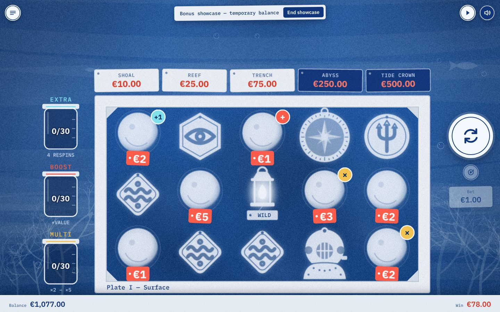
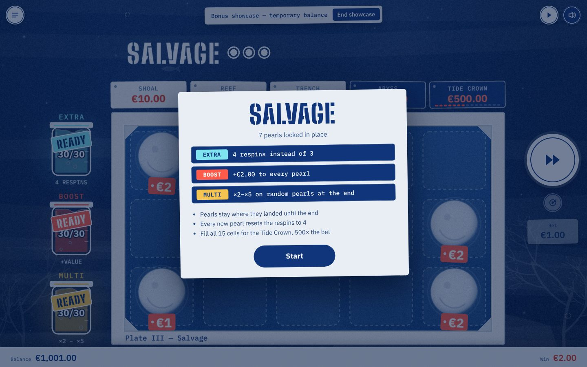
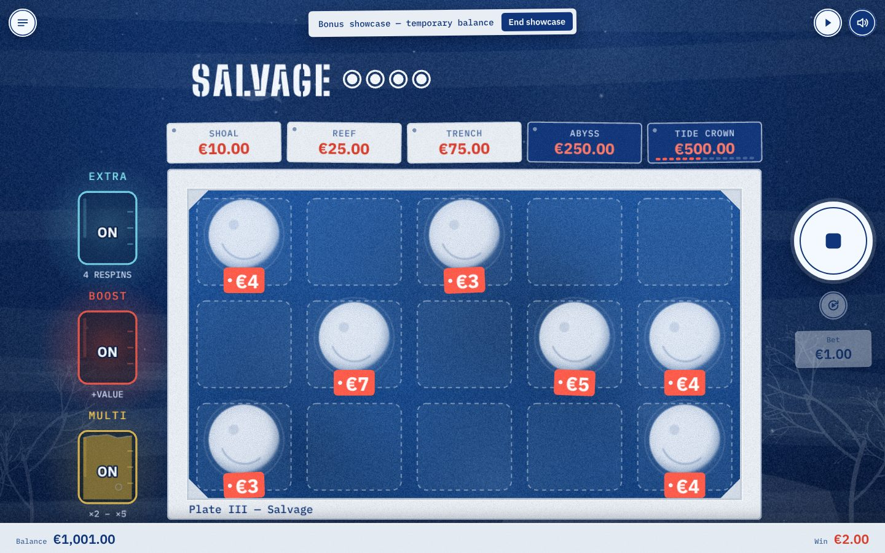
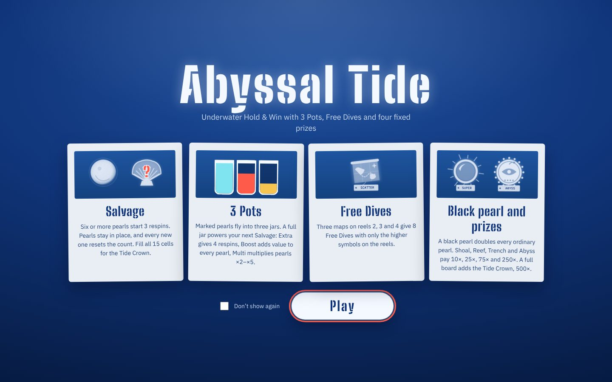
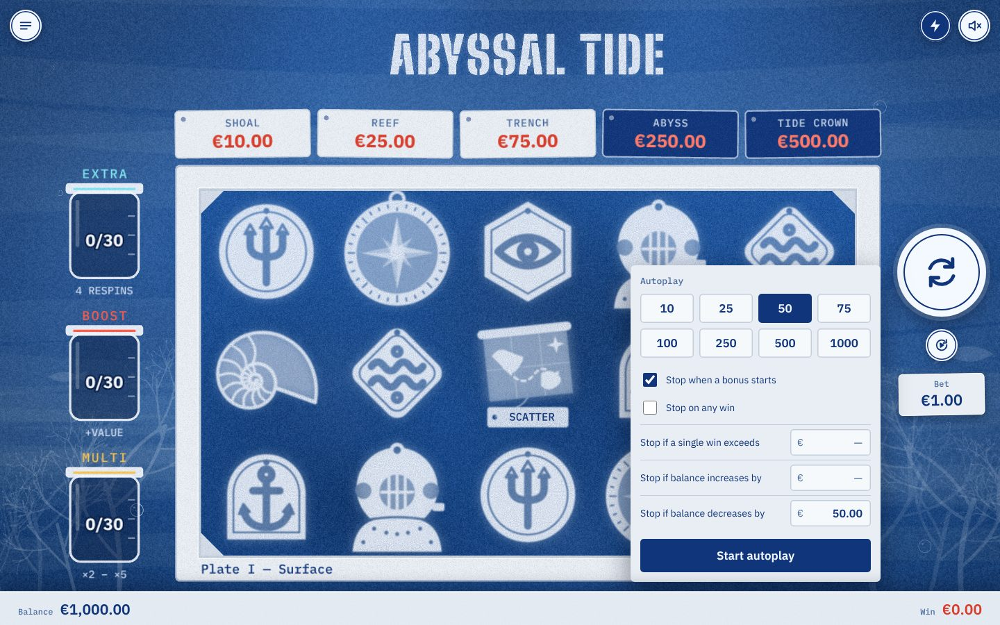
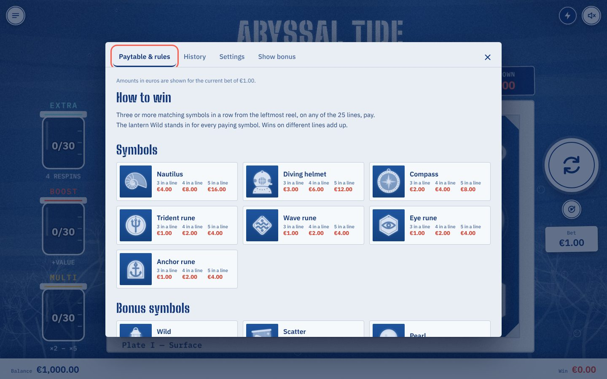
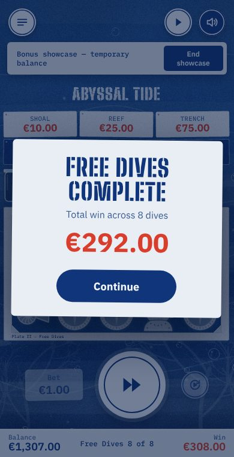
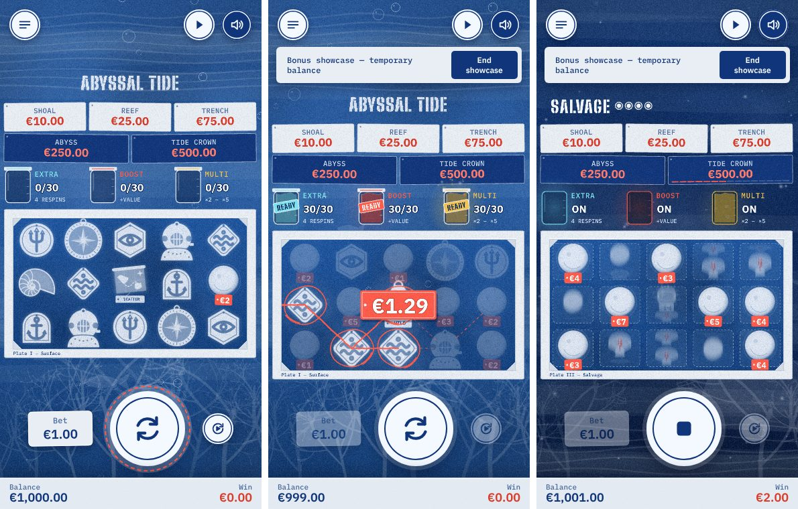

# Abyssal Tide

A 5×3, 25-line underwater slot with **Free Dives** (free spins), **Salvage** (Hold & Win with Super and Mystery) and **3 Pots**, a bonus accumulator that powers up Salvage. It is built from my own game design document ([docs/GDD.uk.md](docs/GDD.uk.md)) as a portfolio project.

The same rules engine runs in the browser for the offline demo and on a game server (`server/`: Fastify, PostgreSQL, server-side RNG). The reusable parts live in `packages/` as `@slotkit/*`, so the next game starts from them rather than from a copy of this one: game time, reel board, bottom-bar controls, paytable, and a symbol pack with a Spine character.

Stack: TypeScript, PixiJS v8, GSAP, Spine, AssetPack, WebAudio, Fastify, PostgreSQL, Vite, Vitest and Playwright. The demo balance is in euros, with no real money.

**Case study:** [`site/index.html`](site/index.html), with a 70-second video. CI builds it into the monorepo site under `/abyssal-tide/`, with the playable demo at `/abyssal-tide/play/` and the symbol gallery at `/abyssal-tide/gallery/` (see `.github/workflows/ci.yml` in the repository root).

The art direction is a **cyanotype**, after Anna Atkins' 1843 sun-prints of algae: salvaged objects printed as white photograms on Prussian-blue paper, mounted in a museum mat labelled «Plate I — Surface». Coral pencil is the only accent and marks money and wins: hand-drawn loops around winning symbols, lines, price tags and rubber stamps for features.

All graphics and sound are generated in code. SVG photograms (with paper grain from `feTurbulence`) are rendered by a build step (`npm run assets`): headless Chrome rasterises them and AssetPack packs them into an atlas. The big-win character is a Spine skeleton generated in code. Music and effects are synthesised with WebAudio, so the repository has no hand-made image or audio files.

| Marked pearls fly into the jars | Salvage start screen |
|---|---|
|  |  |
| **Salvage with all three pots** | **Start screen** |
|  |  |
| **Autoplay settings** | **Paytable in euros** |
|  |  |
| **Free Dives end screen** | **Portrait** |
|  |  |

## What it shows

- **A rules engine separate from the presentation.** `step(state, request, provider) → { state, result }` is a pure function with no DOM, timers or storage. The same code runs in the browser and on the server, and the client only plays back the results it receives.
- **A game server shaped like an RGS** ([server/README.md](server/README.md)). Fastify exposes launch, play, session, history, top-up and reset, with JSON-schema validation and bearer tokens. Every request is a PostgreSQL transaction that locks the player's row, and steps are stored by `(player, stepId)`, so a repeat returns the stored result without a second debit. Every bet and win goes into a ledger. The RNG is `crypto.getRandomValues` with unbiased ranges. Open the game with `?server=http://localhost:8787`; if the server is down it falls back to offline play and says so.
- **Money as integer euro cents.** There are 16 bet levels from €0.25 to €50, as in 3 Oaks slots; the GDD bets 1/2/5/10 are €1, €2, €5 and €10 among them, and the 1,000-credit start is €1,000.00. Every payout is a multiple of the bet, so amounts never leave whole cents. The HUD, symbols, fixed prizes and paytable show euros (`€12.40` in English, `12,40 €` in Ukrainian).
- **Server-like result source.** Every step is committed atomically (result and balance are written together). A repeated `stepId` returns the stored result without touching the balance. A lost response is retried with the same `stepId`. The session survives a page reload, including mid-respin and mid-collect.
- **A client state machine that follows the GDD transition table.** Every transition goes through one guard (`GameFlow.go`), which can be watched live with *Settings → Show state machine*.
- **Simultaneous triggers in the specified order:** line pays → +8 Free Dives recorded → Salvage → Free Dives intro or continuation. A bonus on the last Free Dive finishes before the series summary, and a retrigger on the last dive continues the series.
- **3 Pots, a bonus accumulator.** About one base-game pearl in five carries a coloured mark. When it lands, the mark flies along a trail into its jar (Extra, Boost or Multi); every bet level keeps its own jars. A jar holds 30 marks; a full one pours into the next Salvage and empties:
  - **Extra**: Salvage starts with 4 respins instead of 3, and every new pearl resets the count to 4.
  - **Boost**: every starting pearl gains +1, +2, +3 or +5× bet.
  - **Multi**: when the respins run out, 1 to 3 random pearls are multiplied by ×2, ×3 or ×5.

  Each pot is active in about 28% of Salvages and all three in 13%. The average Salvage pays 35× bet without pots and 52× with at least one.
- **Screens and transitions.** A start screen explains Salvage, 3 Pots, Free Dives and the prizes with real symbol art, and can be turned off. Salvage and Free Dives each open with a screen that waits for the player and lists what is active (for example «Extra: 4 respins instead of 3»), and close with a total. Entering a bonus plays a full-screen «plunge»: an exposure flash, rings, bubbles and a camera punch.
- **Slot feel:** reels stop strictly one after another, with quick stop, three speeds, skippable big-win, reveal and collect episodes, a dive transition between three environments, and per-cell respins that roll like tiny drums. Each symbol type has its own win animation. All animations are listed in [docs/ANIMATIONS.uk.md](docs/ANIMATIONS.uk.md).
- **Wins you notice and tension you hear:**
  - Every win counts up on a large coral tag in the middle of the reels. The duration, size and chord grow with the win, and winning symbols come alive in a left-to-right wave with bubble bursts.
  - Each pearl that lands in a spin rings one step higher on a pentatonic scale. From the fourth pearl on, landed pearls pulse while the remaining reels spin.
  - During anticipation the reel trembles, only ordinary symbols dim, and a rising drone with an accelerating heartbeat plays.
  - In Salvage the Tide Crown tag fills with 15 marks as cells lock, and pulses when two or fewer are left. The last respin pulses the remaining light in coral, with a heartbeat. The last Free Dive gets a «Last dive» stamp.
- **Presentation and controls modelled on 3 Oaks Gaming games:**
  - Spin, autoplay and the bet button sit in one column on the right (a row under the field on phones). Speed and sound are in the top corner, and a thin strip at the bottom shows only balance and win. There are no «press Spin» hints.
  - The bet is picked from a grid of 16 levels instead of +/− steppers.
  - **Holding Spin** (mouse, touch or Space) runs continuous turbo spins until released. A short press still means spin, quick stop or skip.
  - **Autoplay** has a round count (10 to 1,000) and stop conditions: when a bonus starts, on any win, if a single win exceeds an amount, and if the balance rises or falls by an amount. The settings are remembered.
  - **Fixed prizes above the reels** (Shoal, Reef, Trench, Abyss and the Tide Crown) show euro amounts for the current bet, and a tag lights up when its prize lands in Salvage. On a portrait screen they wrap into two rows so the amounts stay readable.
- **Every screen.** The layout is chosen by orientation, not width: a phone held sideways keeps the side column of controls, and portrait puts them in a row under the board. The HUD scales with the screen (`--k`, `--kb`), respects notches and the home indicator (`viewport-fit=cover`, safe-area insets), and stays next to the game on monitors wider than 21:10. The board picks whichever of its two compositions gives the larger field. On short screens the start screen, bonus screens and autoplay panel switch to compact layouts.
- **Market rules.** `?jurisdiction=ukgc` (or *Settings → Market rules*) applies the UK Gambling Commission technical standards: at least 2.5 s from one game to the next, no turbo, quick spin, slam stop, hold-to-spin or autoplay, no celebration of wins at or below the stake, net position and session time in the bar, and a reality check (`&rc=` sets its interval in minutes for a demo). A maximum win of 5,000× bet is enforced in the engine for every market: the round ends and any remaining features are forfeited.
- **Robust against stuck animations.** A watchdog wakes the GSAP ticker if the browser froze it (iOS Safari after a tab switch). If a skippable episode makes no progress for 20 seconds it is skipped, and after 32 seconds the player is offered a restore. Every transition goes into a diagnostics ring buffer, and *Settings → Copy diagnostics* puts a report on the clipboard to send with a bug.
- **Recovery, history and replay.** Finished rounds can be replayed step by step from recorded data without touching the RNG. *Show bonus* plays scripted scenarios through the same engine on a temporary balance.
- **Accessibility:** the HUD is in the DOM with real buttons, keyboard control (Space spins, stops and skips; M opens the menu), and focus returns to Spin. Reduced motion is respected, the tab pauses its animation time and sound when hidden, and portrait layout moves the HUD under the field. English and Ukrainian are included.

## Run

The game lives in the [slotkit](../../README.md) monorepo. Run these from the repository root:

```bash
npm install
npm run dev -w @games/abyssal-tide        # http://localhost:5173
npm test                                  # unit tests of every game, package and the server
npm run test:pg                           # server API tests against PostgreSQL (DATABASE_URL)
npm run sim -w @games/abyssal-tide -- 5000000 2026   # math simulation (rounds, seed)
npm run server                            # game server on :8787 (in memory without DATABASE_URL)
docker compose up --build                 # PostgreSQL + server + the game at http://localhost:8080
npm run assets -w @games/abyssal-tide     # re-render the symbol atlas and the Spine character (needs Chrome)
npm run gallery                           # symbol pack gallery with the Spine character
npm run video -w @games/abyssal-tide      # record site/media/abyssal-tide.mp4 (SLOWMO=0.1 without a GPU)
npm run build -w @games/abyssal-tide      # games/abyssal-tide/dist/ (multi-file)
npm run build:single -w @games/abyssal-tide   # one self-contained HTML file (~1 MB)
npx playwright test -c games/abyssal-tide # e2e; CHROME_PATH=/path/to/chrome to use a system browser
```

## Architecture

```
packages/          @slotkit/*: core, board, controls, paytable, symbols-cyanotype (+ assets/: atlas, Spine)
../../server/      Fastify + PostgreSQL around the same engine (RGS-style API, ledger, crypto RNG)
site/              case study page (games/abyssal-tide/ on GitHub Pages)
scripts/           simulation, asset build (Chrome → AssetPack → Spine atlas), video recording
src/               the game: engine, shared rules, result sources, client
```

```
┌──────────── engine/ (pure) ────────────┐   ┌──────── server/ ─────────┐   ┌─────────────── client/ ───────────────┐
│ lineEval   25 lines, best wild variant │   │ LocalResultSource        │   │ flow/GameFlow   FSM + orchestration   │
│ engine     step(): spin / freeSpin /   │──▶│  atomic commit, stepId   │──▶│ view/           Pixi scene, reels,    │
│            respin / collect            │   │  idempotency, history    │   │                 Salvage, fx, env      │
│ outcome    RNG provider (reel strips)  │   │ ReplaySource             │   │ hud/            DOM HUD, menu, a11y   │
│ scripted   scripted provider + DSL     │   │ showcase    scenarios    │   │ audio/          WebAudio synth        │
│ model      strips & weights            │   └──────────────────────────┘   │ art/            SVG → textures        │
└────────────────────────────────────────┘                                  └───────────────────────────────────────┘
```

```
packages/ (repository root)
  rules/              @slotkit/rules     seeded and crypto RNG, max win cap, market profiles (UKGC)
  core/               @slotkit/core      GSAP-driven time, skippable episodes, speed profiles, money format, diagnostics
  board/              @slotkit/board     PixiJS reels, SymbolView with motion presets, win lines, SymbolPack interface
  controls/           @slotkit/controls  hold-to-spin button, bet grid, autoplay with stop conditions, popovers
  paytable/           @slotkit/paytable  paytable and rules described as data, rendered to HTML
  symbols-cyanotype/  @slotkit/symbols-cyanotype  this game's art as a pack, plus a gallery page
```

The packages are npm workspaces that export TypeScript sources, so the game and the packages build and typecheck together. None of them knows about Abyssal Tide's rules. The game extends `SymbolView` for value tags and pot marks, and passes its own bet levels, labels and paytable sections. Each package has a README with its API.

`ResultSource` is the only seam between the client and the game rules. The live game, the bonus showcase and history replay are three implementations of it. That is how replay can avoid running the RNG, and how the showcase stays consistent with real play.

### Step contract

Each step returns the fields required by GDD §5: `roundId, stepId, mode, bet, boardBefore, boardAfter, lineWins, landed, mysteryReveals, freeSpinsLeft, respinsLeft, roundAward, balanceAfter`. It also returns derived flags so the client never re-derives rules: `fsAwarded`, `salvageTriggered`, `superActivated`, `fullBoard`, `bonusTotal`, `next` and `roundComplete`. For 3 Pots it adds `potsBefore`, `pots`, `potHits` (which marks landed where) and `mods` (what the starting Salvage got), so the client animates the jars from data instead of guessing.

### Client states

`loading → restoring | idle → spinning → anticipation → evaluating → bigWin | salvageIntro → respin → reveal → collect → returning → fsIntro → freeDives → fsSummary → idle`

The full table lives in `src/client/flow/GameFlow.ts` (`TRANSITIONS`); an unexpected transition logs a warning.

## Math

The demo model is tuned with `npm run sim` (5,000,000 paid rounds, seed 2026):

| Metric | Value |
|---|---|
| RTP total | **95.90%** |
| base game lines | 56.28% |
| Free Dives lines | 12.86% |
| Salvage from base / inside Free Dives | 23.97% / 2.78% |
| Hit frequency | 17.8% |
| Free Dives trigger | 1 in 260 |
| Salvage trigger | 1 in 161 |
| Average Salvage award | 43.1× bet (35.3× without pots, 52.0× with) |
| Salvage with a pot active | Extra, Boost, Multi about 28.5% each; all three 13.0% |
| Pearl mark | 1 spin in 5 |
| Full board | 1 in ~227,000 |
| Win ≥ 20× bet | 1 in 125 |

Other seeds of 5,000,000 rounds land between 95.9% and 96.2%, so treat the RTP as about 96% ± 0.3.

The paytable pays in multiples of the total bet, as the GDD specifies. That makes line pays large, so the reel strips are deliberately asymmetric between reels to keep the base game near 56%. This is an uncertified portfolio model, not a production math package.

## Tests

- **Unit (Vitest, 79; 86 with PostgreSQL):** 49 for the game, 23 for the packages and 7 for the server API (run again against PostgreSQL when `DATABASE_URL` is set). Paylines and wild variants. Every engine-level acceptance scenario from GDD §5 is covered: one debit per paid spin, five pearls without a trigger, the respin counter 3→2→3→2→1→0 with pearls staying put, identical values for direct and mid-bonus Super with the multiplier applied once, two Mystery shells where the second reveals Super, the full board awarded once, maps and pearls together, a bonus on the last Free Dive counted once in the series, retrigger on the last dive, an idempotent `stepId`, a lost response retried, reload mid-respin and mid-collect, and the showcase scripts. 3 Pots has its own 14: marks only in the base game, per-bet jars, a mark on the trigger spin counting, Extra's 4 respins and reset, Boost only on the starting pearls, Multi only at the finish, older saved sessions loading with empty jars, and modifiers surviving a reload mid-Salvage. Max win: the award is trimmed and Salvage or Free Dives on the capping spin are forfeited. The screen layout rules (orientation, HUD scale, ultrawide margins) are tested as a pure function. The packages cover game time, money formatting, autoplay stop conditions, paytable escaping, pencil strokes, the SVG art, and the Spine skeleton read by the official runtime (with a seamless idle loop). The server tests cover launch, auth and validation, one debit for a repeated `stepId`, two identical requests at the same moment, error statuses, a Salvage interrupted by a new session, and a balanced ledger.
- **E2E (Playwright, 17):** boot, the start screen and turning it off, the 3 Pots showcase with its Salvage start screen, a frozen animation ticker mid-spin that is woken up, autoplay stopping on a balance-loss limit (and remembering its settings), double click = one bet, the bet panel, hold-to-spin (continuous turbo until release, balances add up), showcase on a temporary balance, reload in the middle of Salvage, replay without balance changes, UK rules (no autoplay or turbo, at least 2.5 s per game, net result, reality check), playing through the HTTP server with the balance surviving a reload, falling back offline when the server is down, the portrait HUD with focus returning to Spin, a phone held sideways, and reduced motion. The second Playwright web server starts the game server, so CI exercises it end to end.

## Notes

- Rules were designed with a published slot of the genre as a mechanics reference (see the GDD). Names, art, sound, timings, event ordering and math are original to this project.
- Demo balance only. No real money, and no RTP claims beyond the simulation above.
