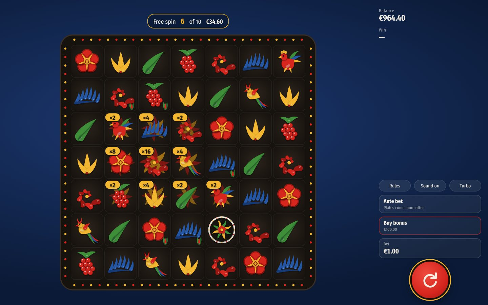
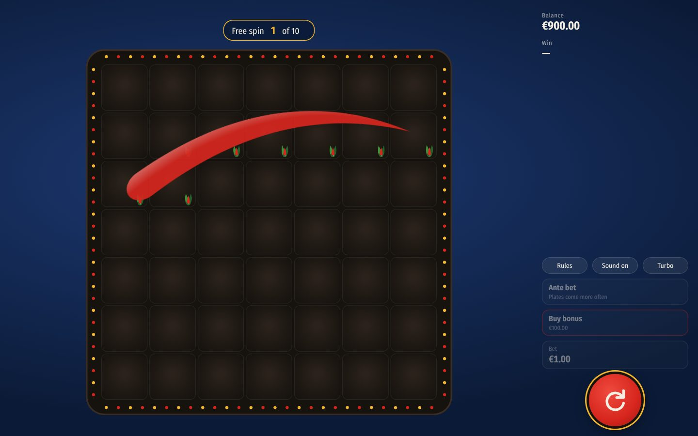
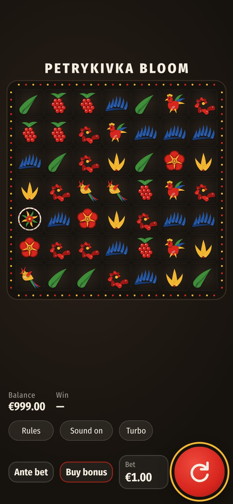
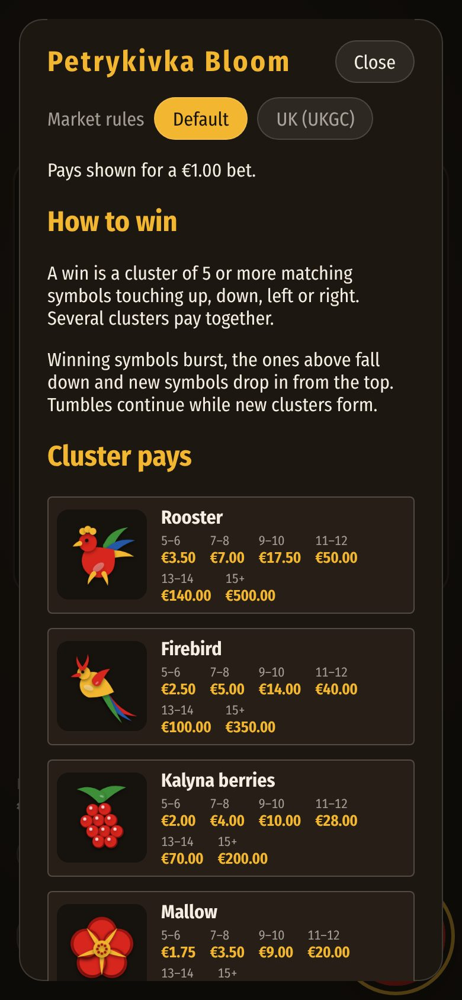

# Petrykivka Bloom

A 7×7 cluster slot with tumbles and **bloom multipliers**, painted in the style of Petrykivka decorative painting. It is the second game in the [slotkit](../../README.md) monorepo: the market rules, controls and paytable come from the shared `@slotkit/*` packages, and the grid engine, math and client are new.

**[Play the demo](https://rashevskyyy.github.io/slotkit/petrykivka-bloom/play/index.html)** · **[Jump to the bonus](https://rashevskyyy.github.io/slotkit/petrykivka-bloom/play/index.html?demo=bonus)** · **[Case study with video](https://rashevskyyy.github.io/slotkit/petrykivka-bloom/)**

| Free spins: flowers stay on the board | The Stroke paints buds before a spin |
|---|---|
|  |  |
| **Phone, portrait** | **Rules on a phone** |
|  |  |

## How it plays

- **Clusters.** 5 or more matching symbols touching up, down, left or right win. Winners burst, the symbols above fall and new ones drop in. The tumbles go on while clusters form.
- **Bloom multipliers.** A cell where a winner bursts gets a bud. The next win there opens a ×2 flower, and every further win doubles it, up to ×128. The flowers under a cluster add up and multiply its pay. In the base game they clear after the spin; in free spins they stay until the bonus ends.
- **The Stroke.** About one base spin in 25 starts with a brush stroke across the board that leaves buds on its path, some of them opened into ×2 flowers. Every bonus starts with one.
- **Free spins.** 3, 4, 5 or 6–7 painted plates give 10, 12, 15 or 20 spins; 3 more during the bonus add 5.
- **Ante bet** (×1.25 per spin) makes the bonus about 1.55 times more frequent. **Bonus buy** starts 10 spins for 100× bet. Both keep the RTP.

## What it shows

- **The whole spin comes from one pure call.** `step(state, request, provider, rules)` returns the starting grid, the Stroke, every tumble (clusters, pays, multipliers, burst cells, refills, cell levels) and the final plates. The client only plays this list back, so the same engine runs in the browser, in tests and in the simulation, and can run on the server unchanged.
- **Grid geometry kept apart from rules.** `engine/grid.ts` finds clusters with a flood fill and collapses columns; `fallPlan()` tells the client which symbol fell from which row.
- **Math tuned by simulation.** A multi-threaded simulator (`worker_threads`) reports the RTP with a 95% confidence interval, the base and bonus shares, frequencies and the win distribution. The RTP was split into a low-variance base part and bonus values by length to tune the weights. See [docs/MATH.uk.md](docs/MATH.uk.md).
- **Money in whole cents.** Pays are stored in twentieths of the bet and bets are multiples of 20 cents, so no win is ever rounded.
- **Market rules from `@slotkit/rules`.** `?jurisdiction=ukgc` (or *Rules → UK (UKGC)*) applies at least 2.5 s between spins, no turbo or skipping, no bonus buy, no celebration of wins at or below the stake, and the session result and time on screen.
- **Art and sound in code.** Every symbol is built from the basic Petrykivka brush strokes (the seed, the comb, the curl) on Canvas 2D, each with its own silhouette so the board reads without colour. The Stroke is a PixiJS `MeshRope` along a Bézier curve. Sound is synthesised with WebAudio on a D-minor pentatonic scale: plucked strings, bells and a brush swish.
- **The same game server.** With `?server=http://localhost:8787` every step goes through the shared Fastify + PostgreSQL server (`/api/petrykivka-bloom/`): one transaction per step, idempotent step ids, a ledger, the UKGC rules enforced on the server. A failed request is retried with the same step id; an unreachable server falls back to the offline demo with a notice.
- **Feature showcase.** *Rules → See the features* (or `?demo=chain|stroke|bonus`) plays a real round from a fixed seed on a temporary balance. `scripts/find-scenarios.ts` searches the seeds.
- **Presentation layer apart from the game.** `src/client/fx/` draws a painted scene behind the board (branches with pointer parallax, drifting petals, lacquer grain and sheen, a night sky in free spins) and a camera over it: glowing cluster outlines, bloom, shockwaves, punch and shake scaled to the size of the win, a cinematic entry into the bonus and a big-win celebration. The board only reports what happened (`BoardEvents`), so the effects never touch the game logic. Filters are switched on only while they are active; weak phones and reduced motion get a light version, and `?fx=low|high` forces either.
- **Anticipation.** When two plates have landed, the remaining columns pause and fall slower while the board waits for the third.
- **Layouts for every screen.** The board and the controls sit side by side on a monitor or a phone held sideways, and stack on a portrait phone. Short landscape screens get a compact control column. A bonus in progress continues after a page reload.

## What it reuses

| From the kit | New in this game |
|---|---|
| `@slotkit/rules`: RNG, max win cap, market profiles | 7×7 grid engine: clusters, tumbles, bloom levels, the Stroke |
| `@slotkit/core`: game time, skippable episodes, money format | Board view: falling symbols, flowers, MeshRope stroke |
| `@slotkit/controls`: bet panel, spin button, popovers | Math model and simulator |
| `@slotkit/paytable`: rules and pays as data | Petrykivka symbol art and sound |

## Run

From the repository root:

```bash
npm install
npm run dev -w @games/petrykivka-bloom      # http://localhost:5173
npm test                                    # all unit tests, this game's are in games/petrykivka-bloom/tests
npm run sim -w @games/petrykivka-bloom -- 10000000 2027 2   # rounds, seed, threads
npm run build -w @games/petrykivka-bloom    # games/petrykivka-bloom/dist/
npm run e2e -w @games/petrykivka-bloom      # Playwright; CHROME_PATH=/path/to/chrome to use a system browser
npm run scenarios -w @games/petrykivka-bloom   # search seeds for the feature showcase
npm run video -w @games/petrykivka-bloom    # record site/media/petrykivka-bloom.mp4 (needs vite preview on :4175; SLOWMO=0.25 without a GPU)
npm run server                              # the shared game server on :8787, then open ?server=http://localhost:8787
```

## Layout

```
src/engine/    grid.ts (clusters, collapse), engine.ts (step), outcome.ts (RNG provider, Stroke), model.ts (weights)
src/shared/    config, symbols and paytable, step types
src/client/    art.ts (Canvas brush strokes), BoardView.ts (Pixi), Flow.ts, Hud.ts, rules.ts, sound.ts,
               source.ts (offline and showcase sources), remote.ts (server source), scenarios.ts
scripts/       simulate.ts, find-scenarios.ts, record-video.mjs
tests/         grid, engine and math tests
e2e/           Playwright scenarios
site/          case study page and its media
docs/          MATH.uk.md
../../server/src/petrykivka.ts   this game's server routes
```

Comments and docs are in Ukrainian, like the rest of the repository; this README is in English.
